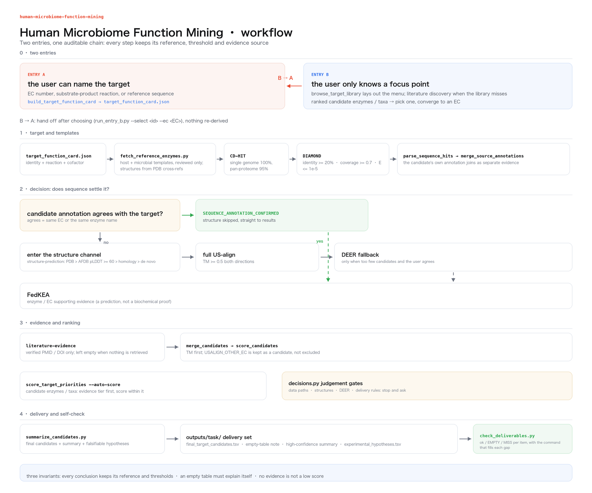

# Human Microbiome Function Mining Plugin

DeepSeek Harness (dsh) plugin for discovering candidate proteins with a target enzyme function from human-associated microbial genomes. Chinese version: [README.md](README.md)

**What it does**: turns "I am looking for this function" into an auditable mining chain — standardize the target → templates and deduplication → sequence screening → annotation decision → (when needed) structural evidence → enzyme/EC cross-check → ranking → delivery set and self-check. Every step keeps its reference, thresholds and evidence source, so a conclusion can be recomputed and challenged.

**What it is not**: not a hosted service, does not bundle DIAMOND/CD-HIT/US-align/DEER/FedKEA/Bakta/SignalP, does not provide compute. External tools run only when their path is reachable *and* the user allows it; otherwise the plugin prints the exact command and consumes the returned files.

Start with [QUICKSTART.md](QUICKSTART.md) for install and first run, [DELIVERY.md](DELIVERY.md) for what ships and how to adapt it, and [docs/workflow.en.png](docs/workflow.en.png) for the workflow picture.

---

## Two ways in

Split by what the user already has. They are not two pipelines: **entry B converges on a concrete target and then hands off to entry A**.

| What the user has | Where to start | Key skill |
| --- | --- | --- |
| A target: enzyme name, EC number, substrate-product reaction, or a sequence | **Entry A · explicit target** (start directly, do not detour through the library) | `build-target-function-card` |
| Only a focus point: a process, a phenotype, a body site, or "which microbes matter" | **Entry B · converge from the library or literature** | `browse-target-library` / `run_entry_b.py` |

Both meet at `target_function_card.json`; the main flow is identical afterwards. **When the target is known, do not route through the library** — it is an extra step with no payoff.

---

## Core workflow



(Chinese version: [docs/workflow.zh.png](docs/workflow.zh.png); generated by `docs/make_workflow_diagram.py`. Full rules: `references/workflow.md`.)

```text
reference templates (host + microbial, reviewed only; structures from PDB cross-refs)
  -> CD-HIT deduplication (single genome 100%, pan-proteome 95%)
  -> DIAMOND (identity >= 20% · coverage >= 0.7 · E <= 1e-5)
  -> parse_source_annotations (the candidate's own annotation, separate evidence)
  -> fast path: annotation agrees with the target -> SEQUENCE_ANNOTATION_CONFIRMED -> skip structure
     otherwise -> structure-prediction (PDB > AFDB pLDDT>=60 > homology > de novo)
                -> full US-align (TM >= 0.5, both directions)
                -> too few candidates and the user agrees -> DEER fallback
  -> FedKEA (enzyme/EC cross-check) · optional SignalP (signal peptide)
  -> literature-evidence (verified PMID/DOI only)
  -> merge_candidates -> score_candidates (TM first) -> falsifiable hypotheses + experimental design
```

Three things that are easy to get wrong:

- **The template source decides whether a hit is possible**: under one EC the host and bacterial folds differ. In example 1 all seven hits came from bacterial templates and zero from host templates.
- **The fast path needs three things at once**: a reference (the template matched), alignment strength (identity/coverage/E), and the candidate's **own annotation** agreeing with the target. Missing any one is not a confirmation.
- **A ranking answers "what first" only**: TM comes first by default because a convergent or moonlighting enzyme's annotation and EC often disagree with the target; `--rank-by priority` restores tier-first order.

---

## The twelve skills

| skill | Purpose |
| --- | --- |
| `intake-environment` | Before any tool: where it runs, what exists, whether the network is reachable |
| `browse-target-library` | Entry B: lays out body site → process → enzyme for the user to pick |
| `build-target-function-card` | Entry A: standardizes the target into `target_function_card.json` |
| `functional-dark-matter-discover` | Main flow: target → candidates → experimental design |
| `screen-sequence-candidates` | CD-HIT + DIAMOND sequence screening |
| `structure-prediction` | PDB > AFDB (pLDDT >= 60) > homology > de novo |
| `screen-structure-candidates` | Full US-align; DEER only when too few candidates and the user agrees |
| `literature-evidence` | Verified PMID/DOI only; never fabricates a citation |
| `genome-search` / `genome-download` / `genome-annotation` | Pick an assembly by source → download → Bakta annotation |
| `prepare-cro-work-order` | Turns the candidates into a work order a vendor can quote |

---

## Entry B: library, candidate lists, handoff

### The library (`library/`)

Three levels: `domain` (body site) → `process` (physiology) → `enzyme` (what actually gets screened). Each enzyme carries EC and confidence, reaction, substrate/product, the recommended entry point (`reaction`/`ec`/`sequence`), a `dark_matter` flag, priority, and one falsifiable experiment.

| Domain | Contents | Status |
| --- | --- | --- |
| `library/skin.json` | 1 process / 1 enzyme (sphingomyelinase, EC 3.1.4.12), with verified PMIDs | `curated` |
| `library/skin_xenobiotic.json` | 6 xenobiotic classes (preservatives / azo dyes / PAHs / drug deconjugation / epoxide hydrolysis / fragrance), none with per-item evidence | `starter` |

The library is **deliberately small** and entirely optional: empty it and entry A, genome preparation, sequence/structure/annotation/literature steps, ranking and the CRO work order still work — the only cost is four auto-derived components in `--auto-score`. The library is a **curation prior, not evidence**: `evidence_status` is `curated_prior` with empty `evidence_refs`, and only `attach_library_evidence.py` can promote an entry to `literature_verified` given real PMID/DOI identifiers; `--validate` rejects empty or malformed promotions.

### When the library misses

```bash
# ask the router first: it classifies the question, composes commands, and turns site/phenotype into search terms
python3 scripts/resolve_target_intent.py --query "which enzymes are worth looking at in oral periodontitis"

# to cover a direction long-term: spec -> starter domain -> validated write
python3 scripts/build_library_domain.py --init --domain oral --output specs/oral.json
python3 scripts/build_library_domain.py --build --spec specs/oral.json --output library/oral.json
```

None of these produce factual assertions: the router only classifies and composes commands (a hit at another body site is labelled "usable as an analogy only", not coverage), and the builder refuses empty fields, forces `content_status: starter`, and forces `evidence_refs` empty.

### Candidate lists and the handoff

With only a focus point, one command runs the route:

```bash
# search the library -> literature discovery if it misses -> the two ranked tables
python3 scripts/run_entry_b.py --topic "skin xenobiotic metabolism" --site skin \
    --output-dir outputs/task/entry_b
```

It writes `recommended_enzymes.tsv` / `recommended_taxa.tsv`. The two use different bars because the action behind them differs:

- **taxa**: the ranking threshold — `priority_score >= 3.0` is `selected`, and that is the recommended table (exactly three in example 4). Rows below it are `defer`: still in the full table, not recommended.
- **enzymes**: no pass mark. The recommended table is the ranked list of rows with **at least two scored components**; few components are derivable before screening, so a fixed cut-off would empty the list. Which one to screen is the user's call by rank.

The full pool stays in `candidate_enzymes.tsv` / `candidate_taxa.tsv`. Ordering is **evidence first**: a hand-scored entry with no references must not outrank one with references, because scores are not comparable across sources.

Candidate enzymes can also come from literature the plugin retrieves itself instead of someone else's table:

```bash
python3 scripts/discover_enzyme_candidates.py --site skin \
    --terms "skin microbiome xenobiotic metabolism enzyme" --limit 25 \
    --output outputs/task/discovery/enzyme_registry.tsv \
    --evidence outputs/task/discovery/literature_evidence.tsv
```

It records only enzyme names that literally appear in the retrieved abstracts, records an EC only when it appears in the same sentence, and attaches a PMID plus the sentence to every candidate.

Pick a row and hand off to entry A (`--select` reads only that row's name/EC/evidence, nothing is re-derived; if the row has no EC it stops and asks):

```bash
python3 scripts/run_entry_b.py --topic "skin xenobiotic metabolism" --site skin \
    --select <target_id> --ec <EC> --proteome <candidate proteome>.faa --output-dir outputs/task/entry_b
```

---

## Ranking and the evidence gate

Pre-screening ranking (a defensible order among a dozen candidates):

```bash
# seed a scoring skeleton from the library (values blank, nothing invented), fill it, then rank
python3 scripts/score_target_priorities.py --seed-from-library library/skin_xenobiotic.json --output outputs/task/priorities
python3 scripts/score_target_priorities.py \
    --enzymes outputs/task/priorities/enzyme_registry.seed.tsv \
    --taxa outputs/task/priorities/taxa_registry.seed.tsv \
    --site skin --auto-score --output outputs/task/priorities
```

`--auto-score` derives up to **nine components** (six enzyme, three taxa), each labelled in `score_sources` (`auto:library` / `auto:registry` / `auto:literature` / `auto:reference_enzymes` / `auto:genome_search`). The three that stay manual are `assay_feasibility`, `experimental_accessibility` and `disease_site_relevance` — the plugin does not judge whether an assay is practical. A component with no evidence is recorded as **`missing`, never as a low score**.

Two gates stop "rank anyway" behaviour:

| Flag | Meaning |
| --- | --- |
| `--require-min-criteria N` | at least N components have a value (manual counts) |
| `--require-min-evidence N` | at least N components are data-derived (`auto:*` only) |

Withheld rows get no rank and can never be `selected`, but they stay in the table (hiding them makes the output look more complete than the evidence), with the reason in `withheld_rows.tsv`. If nothing qualifies, the script says "not no candidates, but not enough evidence to rank". Details: `references/thresholds.md`.

---

## Judgment points

Every call the plugin will not make for you is an explicit option, asked **by stage** and recorded in `environment.json` under `decisions`: `start` asks for candidate data, `structure` asks about structure files and their source, DEER is only asked when US-align leaves too few candidates, and ranking and delivery ask at their own step.

When a step is reached and its decision is unanswered, the script **stops and prints the options** (`DECISION REQUIRED`) instead of picking a default: `run_deer.py` exits 3, `run_usalign.py` writes a `blocked` checkpoint when the structure directory is empty, and `summarize_candidates.py` refuses to deliver an unexplained empty table. `--probe` reports an unanswered decision as `needs_decision` — **not answering is never consent**. Full list: `references/decision_points.md`; the two mandatory data questions: `references/data_intake.md`.

---

## Delivery set

`outputs/task/` must contain:

| File | Meaning |
| --- | --- |
| `final_target_candidates.tsv` | final candidates, one row per protein, with the template it matched and the alignment |
| `final_target_candidates_note.md` | required when the table is empty ("empty" is not "none") |
| `high_confidence_candidate_summary.tsv` | per-candidate evidence summary |
| `experimental_hypotheses.tsv` | falsifiable hypotheses |
| `scored_candidates.tsv` | the scored table |

```bash
python3 scripts/check_deliverables.py --project-dir <project dir>
```

It reports ok / EMPTY / MISS per item and prints the command that fills each gap. **A zero-hit run is a result**: what was screened, at which thresholds, and what to try next all land in the note.

---

## Usage examples

Four examples, ordered by what the user already has; every number comes from a real run.

### Example 1: from a metabolic reaction

```text
"Known reaction products are ceramide and phosphocholine. Predict whether the skin
microbe Staphylococcus epidermidis (GCF_038181645.1) contains related metabolic genes
and provide a verifiable experimental design."
```

`build-target-function-card` infers EC 3.1.4.12 → preflight → CD-HIT (100%) + DIAMOND → join `.gbff` annotations → annotation agrees, so the fast path applies.

| Item | Value |
| --- | --- |
| DIAMOND hits | 7, all pointing at **WP_002468583.1** |
| Best alignment | 52.2% identity / 89.2% coverage / E=7.5e-107 |
| Templates hit | all 7 from **bacterial** phospholipase C templates; **0** host sphingomyelinase templates |
| Verdict | `SEQUENCE_ANNOTATION_CONFIRMED`, structure skipped |

**Why it matters**: the host templates missed and the bacterial ones hit — under one EC the folds differ, so a host enzyme as query finds no bacterial gene.

### Example 2: from an enzyme / EC, several genomes

```text
"Predict whether three skin microbiome genomes (S. pyogenes, S. thermophilus, S. xylosus)
contain genes related to neutral sphingomyelinase (EC 3.1.4.12) and provide a verifiable
experimental design."
```

| Item | Value |
| --- | --- |
| Sequence channel | **0 hits** in all three genomes, even with the coverage filter relaxed |
| Structure channel | US-align over 1,625 / 1,744 / 2,795 structures → **2 / 3 / 1** candidates |
| FedKEA | promotes 2 to `USALIGN_TARGET_EC` (TM 0.7088, 0.6988); the rest are `USALIGN_OTHER_EC` |
| DEER | not used |

**Why it matters**: the first run skipped FedKEA, so the final table was empty; the empty-table note now opens with "check whether FedKEA was run".

### Example 3: from a reference sequence

```text
"Predict whether the gut microbe Bifidobacterium adolescentis may encode the key enzyme of
human melatonin synthesis, DDC (P20711), and provide a verifiable experimental design."
```

| Item | Value |
| --- | --- |
| Sequence channel | **0 hits** |
| Structure channel | 18 candidates, TM 0.60-0.71 both directions, best template 3RBF |
| FedKEA | **other ECs** for all of them (4.1.2.48, 2.1.2.1, 2.6.1.x, 4.4.1.13, 2.8.1.7) |
| Verdict | all 18 are `USALIGN_OTHER_EC` |

**Why it matters**: the delivery does **not** say "no candidate" — these are structurally similar proteins whose predicted EC differs, delivered with a side-by-side assay for the target EC and the predicted one.

### Example 4: from a focus point, rank first, then hand off

```text
"I am interested in the physiological processes of skin xenobiotic metabolism.
Which metabolic enzymes and which microbes are worth looking at?"
```

Entry B → search the library (6 classes, all starter) → literature discovery → two ranked tables:

| Rank | Recommended enzyme | EC | Evidence |
| --- | --- | --- | --- |
| 1 | azoreductase (Azo1) | - | `literature_verified` (PMID 33385118) |
| 2 | beta-glucuronidase | 3.2.1.31 | `curated_prior` (extrapolated from gut) |
| 3-6 | epoxide hydrolase / 4-hydroxybenzoate 1-hydroxylase / naphthalene 1,2-dioxygenase / alcohol dehydrogenase | - | `curated_prior` |

| Rank | Recommended microbe | Site presence | Metabolic plausibility |
| --- | --- | --- | --- |
| 1 | *Cutibacterium acnes* | 5.000 | 4.000 |
| 2 | *Staphylococcus epidermidis* | 5.000 | 4.000 |
| 3 | *Staphylococcus aureus* | 5.000 | 3.000 |

The follow-up — "mine alcohol dehydrogenase in *S. epidermidis*" — is a family name, not a target; after converging on EC 1.1.1.1 it hands off to entry A: 26 reviewed templates, 24 alignments, four proteins through the fast path.

| Rank | Candidate | Template | Identity | Coverage | E | Annotation |
| --- | --- | --- | --- | --- | --- | --- |
| 1 | WP_002438761.1 | sp\|P39451\|ADHP_ECOLI | 68.5% | 99.7% | 2.1e-161 | **AdhP** |
| 2 | WP_002456130.1 | sp\|P0A9Q7\|ADHE_ECOLI | 49.3% | 95.8% | 8.9e-274 | bifunctional AdhE |
| 3 | WP_002470719.1 | sp\|P9WQB9\|ADHD_MYCTU | 39.9% | 97.8% | 9.9e-76 | zinc-dependent ADH |
| 4 | WP_002456033.1 | sp\|Q0KDL6\|ADH_CUPNH | 34.9% | 96.2% | 9.5e-62 | zinc-dependent ADH |

A 2,3-butanediol dehydrogenase at 25.4% identity is **not** confirmed (its annotation is a different activity).

Entry B now retrieves literature per candidate (`literature_for_registry.py`) before scoring:

| Rank | Enzyme | Score | Scored components |
| --- | --- | --- | --- |
| 1 | azoreductase | **3.400** | 6/6 |
| 2 | epoxide hydrolase | 3.400 | 6/6 |
| 3 | 4-hydroxybenzoate 1-hydroxylase | 3.400 | 6/6 |
| 4 | alcohol dehydrogenase | 3.400 | 6/6 |
| 5 | beta-glucuronidase | 3.067 | 5/6 (structure lookup hit 3 records, resolved 0 PMIDs) |
| 6 | naphthalene 1,2-dioxygenase | 2.733 | 5/6 (same) |

Taxa: *C. acnes* / *S. epidermidis* 3.467, *S. aureus* 3.333.

5 is the ceiling and a score below it is normal: with no `--disease` the phenotype component is dropped as `not_applicable` (so six components, not seven), and a component without evidence stays a gap rather than becoming a low value - 3.4/5 therefore means "all six components have a source", not "this enzyme is 68% good".

The second stage was re-run (DIAMOND 2.1.11, 13-column `--outfmt`): 26 reviewed templates against 2,372 proteins produced 24 alignments, all four candidates are `SEQUENCE_ANNOTATION_CONFIRMED`, and `check_deliverables.py` reports complete (4 final rows).

**Why it matters**: example 4 has two stages — the first needs only the library and literature and yields the ranking tables, so **reproducing only the first stage is a legitimate stopping point**; the second stage needs a proteome and the alignment tools. If the template set contains a same-species entry (*S. epidermidis*'s own reviewed ADH) the best hit becomes 100%, which is a self-match, not cross-species evidence.

---

## Install and first run

```bash
npx -y @deepseek-ai/dsh plugin --profile web add ./human_microbiome_function_mining
npx -y @deepseek-ai/dsh plugin --profile web add github:Liuyixin-lily/dsh-bio-human-microbiome-function-mining
```

`postinstall` installs the agent preset into `~/.dsh/.agent-presets/`. Then run the bundled self-check (no external tools needed):

```bash
python3 scripts/example_test.py     # ends with "example test passed"
```

After that, answer the environment questionnaire and fill `project.json`:

```bash
python3 scripts/intake_environment.py --ask --task screening     # ask only what this task needs
python3 scripts/intake_environment.py --init --output environment.json
python3 scripts/intake_environment.py --probe --config environment.json \
    --output-card environment_card.json --output-report environment_report.md
```

Each tool lands as `ready` / `unverified` / `missing` / `not_provided`: only `ready` tools run, and only
when local execution is allowed. A binary that cannot report a version stays `unverified`, because that
problem only shows up at run time. `--emit-config` writes the `tools` block of `project.json` so you do
not fill it twice. Full steps: **[QUICKSTART.md](QUICKSTART.md)**. If you remember one thing: **settle the target first, then ask about the environment only as far as the task needs**.

---

## Tool execution boundary

1. Ask for exact locations: data files and executables (with versions and whether local execution is allowed). Checklist: `references/input_paths.md`.
2. If data or tools live on a remote host, ask for `user@host` and absolute paths on that host.
3. Run `python3 scripts/preflight_inputs.py --project project.json --require-tools`; it reports `ok` / `placeholder` / `missing` / `invalid` per path.
4. Reachable and allowed → run it, and record the command and version in provenance.
5. Reachable but the user only wants the command, or unreachable → print the exact command and wait for the returned files.
6. Never fabricate tool output; never call the FedKEA web server programmatically.

**A path is not a working tool**: a binary that cannot report a version is `unverified`. **Permission and capability are separate**: with `allow_local_execution` false, even a fully equipped machine only gets a command list.

---

## Directory layout

```text
human_microbiome_function_mining/
├── package.json / index.js / src/ / cordis.patch.yml   # dsh entry (skill registration + system prompt)
├── preset/                      # agent preset (persona + orientation skill)
├── agents/deepseek.md           # agent prompt and guardrails
├── skills/                      # 12 skill documents + their scripts/ and references/
├── scripts/                     # parsers, wrappers, ranking and self-check scripts
├── schemas/                     # evidence-table contracts (TSV / JSON)
├── references/                  # workflow, thresholds, decision points, fallback, evidence rules
├── library/                     # optional target index (domain -> process -> enzyme)
├── docs/                        # workflow diagram (zh / en) and its generator
├── resources/taxa/              # oral / skin species lists and the GMPS manifest
├── projects/ demo/ examples/    # example configs, a real demo, the quarantined legacy library
└── config.*.example.json        # lean / full configuration references
```

---

## Also included

- **Species lists** (`resources/taxa/`): 230 oral and 257 skin species with assembly accessions and measured abundance. They are not a target library (no processes, no enzymes) and provide one scoreable component only (site presence), so used alone the ranking is mostly tied. See `resources/taxa/README.md`.
- **GMPS** (`references/gmps.md`): gut microbial protein structures (~2.7 million AlphaFold2 models) as a gut candidate pool; gut only, models are predicted, and a structural hit is not a function.
- **CRO work order** (`prepare-cro-work-order`, `scripts/build_cro_work_order.py`): turns the target and candidates into a work order a vendor can quote (M1-M10 modules, verbatim sequences, pre-registered decision rules). Prices and turnaround times stay blank for the vendor; with no sequence it writes `cro_sequences.MISSING.md` rather than inventing one.

---

## Further documentation

- [QUICKSTART.md](QUICKSTART.md): install, self-check, your own data, delivery commands.
- [DELIVERY.md](DELIVERY.md): what ships and how to adapt it.
- [`references/`](references/README.md): workflow / thresholds / decision points / data intake / tool fallback / acceptance criteria.
- [`scripts/README.md`](scripts/README.md), [`schemas/README.md`](schemas/README.md), [`library/README.md`](library/README.md), [`skills/`](skills).
- [docs/workflow.zh.png](docs/workflow.zh.png) / [docs/workflow.en.png](docs/workflow.en.png): the workflow diagram.
