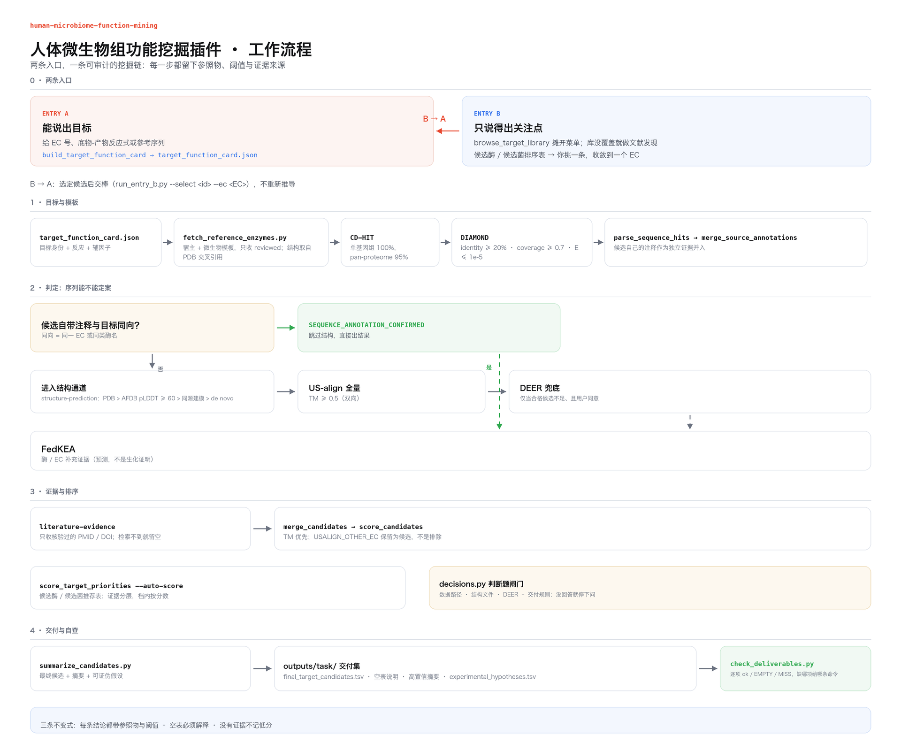

# Human Microbiome Function Mining Plugin

人体微生物组功能挖掘插件 / DeepSeek Harness plugin for discovering candidate proteins with a target enzyme function from human-associated microbial genomes. English: [README.en.md](README.en.md)

**这个插件做什么**：把「我想找某个功能」变成一条可审计的挖掘链——标准化目标 → 模板与去冗余 → 序列筛选 → 注释判定 → （必要时）结构证据 → 酶/EC 交叉验证 → 排序 → 交付集与自查。每一步都留下参照物、阈值和证据来源，结论可以被重算和质疑。

**它不是什么**：不托管服务、不打包 DIAMOND/CD-HIT/US-align/DEER/FedKEA/Bakta/SignalP、不提供算力；外部工具只在「路径可访问 + 用户允许」时才由 Agent 直接执行，否则给出确切命令并消费返回结果。

初次使用先看 [QUICKSTART.md](QUICKSTART.md)（安装与上手），交付内容与改造见 [DELIVERY.md](DELIVERY.md)，流程图见 [docs/workflow.zh.png](docs/workflow.zh.png)。

---

## 两条入口 / Two ways in

按用户手里已经有什么来分。它们不是两套流程：**入口 B 收敛到具体目标后会交棒给入口 A**。

| 用户手里有什么 | 走哪条 | 关键 skill |
| --- | --- | --- |
| 能说出目标：酶名 / EC 号 / 底物-产物反应 / 一段序列 | **入口 A · 显式建档**（直接开始，不经过目标库） | `build-target-function-card` |
| 只知道关注点：某生理过程、表型、部位，或一句「都有哪些菌」 | **入口 B · 从库或文献收敛** | `browse-target-library` / `run_entry_b.py` |

两条路在 `target_function_card.json` 汇合，主流程完全一样。**已知目标时不要绕道目标库**——额外一步，没有收益。

---

## 工作流程 / Core workflow



（[英文版](docs/workflow.en.png)；生成脚本 `docs/make_workflow_diagram.py`。完整规则：`references/workflow.md`。）

```text
模板序列（宿主 + 微生物，仅 reviewed；结构取自 PDB 交叉引用）
  -> CD-HIT 去冗余（单基因组 100%，pan-proteome 95%）
  -> DIAMOND（identity >= 20% · coverage >= 0.7 · E <= 1e-5）
  -> parse_source_annotations（候选自己的注释，独立证据）
  -> 快速通道：注释与目标同向 -> SEQUENCE_ANNOTATION_CONFIRMED -> 跳过结构
     否则 -> structure-prediction（PDB > AFDB pLDDT>=60 > 同源建模 > de novo）
          -> US-align 全量（TM >= 0.5，双向）
          -> 合格候选不足且用户同意 -> DEER fallback
  -> FedKEA（酶/EC 交叉验证）· 可选 SignalP（信号肽）
  -> literature-evidence（只保留核验过的 PMID/DOI）
  -> merge_candidates -> score_candidates（TM 优先）-> 可证伪假设 + 实验设计
```

三个容易踩空的点：

- **模板来源决定能不能命中**：同一个 EC 下宿主与细菌折叠不同。示例 1 里 7 条命中全部来自细菌模板，宿主模板 0 条。
- **快速通道要求三件事同时成立**：有参照物（命中的模板）、有比对强度（identity/coverage/E）、候选**自己的注释**与目标同向。缺任一项都不算确认。
- **排序只回答「先做谁」**：默认 TM 优先，因为趋同/兼职酶的注释与 EC 常常对不上号；`--rank-by priority` 可回到层级优先。

---

## 12 个 skill

| skill | 作用 |
| --- | --- |
| `intake-environment` | 跑任何工具之前：先问在哪跑、有哪些软件、能否联网 |
| `browse-target-library` | 入口 B：把部位 → 过程 → 酶逐级摊开给用户挑 |
| `build-target-function-card` | 入口 A：把目标标准化成 `target_function_card.json` |
| `functional-dark-matter-discover` | 主流程：目标 → 候选 → 实验设计 |
| `screen-sequence-candidates` | CD-HIT + DIAMOND 序列筛选 |
| `structure-prediction` | PDB > AFDB（pLDDT ≥ 60）> 同源建模 > de novo |
| `screen-structure-candidates` | US-align 全量；不足且用户同意才 DEER |
| `literature-evidence` | 只保留核验过的 PMID/DOI，禁止编造 |
| `genome-search` / `genome-download` / `genome-annotation` | 按来源挑装配 → 下载 → Bakta 注释 |
| `prepare-cro-work-order` | 把候选变成可直接询价的委托实验工作单 |

---

## 入口 B：库、候选清单、交棒

### 库（`library/`）

三层索引：`domain`（部位）→ `process`（生理过程）→ `enzyme`（真正拿去筛的目标）。每个酶目标带 EC 与置信度、反应、底物/产物、推荐起手式（`reaction`/`ec`/`sequence`）、`dark_matter` 标记、优先级和一条可证伪实验。

| 域 | 内容 | 状态 |
| --- | --- | --- |
| `library/skin.json` | 1 个过程 / 1 个酶（鞘磷脂酶 EC 3.1.4.12），带已验证 PMID | `curated` |
| `library/skin_xenobiotic.json` | 6 类外源物质代谢（防腐剂 / 偶氮染料 / 多环芳烃 / 药物去结合 / 环氧化物水解 / 香料），均无逐条证据 | `starter` |

库**刻意很小**，且整体可选：清空 `library/` 后入口 A、基因组准备、序列/结构/注释/文献、排序、工作单全都照常，代价只是 `--auto-score` 少 4 个可从库推导的分项。库是**策展先验，不是证据**：`evidence_status` 默认 `curated_prior`、`evidence_refs` 恒空，只有 `attach_library_evidence.py` 在给出真实 PMID/DOI 后才能升级为 `literature_verified`；`--validate` 会拒绝空引用或格式不对的升级。

### 库覆盖不到时

```bash
# 先问路由器：它判断问题形状、给可执行步骤，并把部位/表型拼成文献检索词
python3 scripts/resolve_target_intent.py --query "口腔牙周炎相关菌有哪些酶值得看"

# 想长期覆盖这个方向：spec -> starter 域 -> 校验写盘
python3 scripts/build_library_domain.py --init --domain oral --output specs/oral.json
python3 scripts/build_library_domain.py --build --spec specs/oral.json --output library/oral.json
```

三步都**不产生事实断言**：路由只做分类与命令编排（跨部位命中只标 "usable as an analogy only"，不算覆盖）；扩库脚本拒绝空字段、强制 `content_status: starter`、强制清空 `evidence_refs`。

### 候选清单与交棒

只给关注点时，一条命令走完：

```bash
# 查库 -> 没覆盖就做文献发现（中文题目按固定词表转英文检索词，转不出就问你）-> 两张推荐表
python3 scripts/run_entry_b.py --topic "皮肤外源性物质代谢" --site skin \
    --output-dir outputs/task/entry_b
```

产出 `recommended_enzymes.tsv` / `recommended_taxa.tsv`，只留**至少两项已评**的条目——一项打分排出来的名次只是那一项换了个说法；菌还要额外满足**至少一项证据比"出现在名单里"更具体**（库的 focus_taxon、一条真实引用、或 genome-search 命中），否则 257 个菌会全部入选。完整池在 `candidate_enzymes.tsv` / `candidate_taxa.tsv`。排序**证据优先**：手打分但无引用的条目不可能压过有引用的条目，因为分数跨来源不可比。

候选酶也可以完全由插件自己从文献生成，而不是借用别人的清单：

```bash
python3 scripts/discover_enzyme_candidates.py --site skin \
    --terms "skin microbiome xenobiotic metabolism enzyme" --limit 25 \
    --output outputs/task/discovery/enzyme_registry.tsv \
    --evidence outputs/task/discovery/literature_evidence.tsv
```

它只记录检索到的摘要里**实际出现**的酶名，EC 只在与酶名同一句时记录，每个候选带 PMID 和原文句子。

选定一条后交棒入口 A（`--select` 只读表里那一行的名称/EC/证据，不重新推导；该行没有 EC 就停下来问你）：

```bash
python3 scripts/run_entry_b.py --topic "皮肤外源性物质代谢" --site skin \
    --select <target_id> --ec <EC> --proteome <候选蛋白组>.faa --output-dir outputs/task/entry_b
```

---

## 排序与证据门槛

筛选前排序（在十几个候选之间给出可辩护的名次）：

```bash
# 先从库生成打分骨架（分数留空，不替你编），填完后排序
python3 scripts/score_target_priorities.py --seed-from-library library/skin_xenobiotic.json --output outputs/task/priorities
python3 scripts/score_target_priorities.py \
    --enzymes outputs/task/priorities/enzyme_registry.seed.tsv \
    --taxa outputs/task/priorities/taxa_registry.seed.tsv \
    --site skin --auto-score --output outputs/task/priorities
```

`--auto-score` 最多推导 **9 个分项**（酶 6 + 菌 3），每项在 `score_sources` 里写明依据（`auto:library` / `auto:registry` / `auto:literature` / `auto:reference_enzymes` / `auto:genome_search`）；仍只能手填的是 `assay_feasibility`、`experimental_accessibility`、`disease_site_relevance`——插件不替你判断「这个实验好不好做」。没有证据的分项**记成 `missing`，不记成低分**。

两个门槛拦住「几乎空白也排名」：

| 参数 | 含义 |
| --- | --- |
| `--require-min-criteria N` | 至少 N 个分项有值（人工判断也算） |
| `--require-min-evidence N` | 至少 N 个分项是数据推导的（只算 `auto:*`） |

被扣下的行不给名次、也不会是 `selected`，但仍留在表里（隐藏会让输出看起来比证据更完整），原因写进 `withheld_rows.tsv`。没有一行达标时，脚本明说「不是没有候选，而是证据不足以排序」。详见 `references/thresholds.md`。

---

## 判断题 / Judgment points

插件不替你做的判断全部选项化、按**阶段**提问，并记录在 `environment.json` 的 `decisions`：`start` 问候选数据，`structure` 问结构文件与来源，US-align 候选不足时才问 DEER，排序与交付各自在对应步骤问。

走到某一步而该判断没答时，脚本**停下打印选项**（`DECISION REQUIRED`）而不是用默认值：`run_deer.py` 退出码 3、`run_usalign.py` 在结构目录为空时写 `blocked` checkpoint、`summarize_candidates.py` 在交付表为空时。`--probe` 把未选报成 `needs_decision`——**没选永远不等于同意**。完整清单：`references/decision_points.md`；两个必问的数据问题：`references/data_intake.md`。

---

## 交付集 / Delivery set

`outputs/task/` 必须有：

| 文件 | 说明 |
| --- | --- |
| `final_target_candidates.tsv` | 最终候选，每蛋白一行，带比对模板与一致度 |
| `final_target_candidates_note.md` | 最终表为空时**必须**解释（「空」≠「没有」） |
| `high_confidence_candidate_summary.tsv` | 每个候选的证据摘要 |
| `experimental_hypotheses.tsv` | 可证伪的实验假设 |
| `scored_candidates.tsv` | 打分表 |

```bash
python3 scripts/check_deliverables.py --project-dir <项目目录>
```

它逐项报 ok / EMPTY / MISS，并对缺项给出生成命令。**0 命中也是结论**：筛了什么、阈值多少、下一步该做什么都会写进说明文件。

---

## 使用示例 / Usage examples

四个示例按「用户手里已经有什么」排列，数字都来自真实运行。

### Example 1：从代谢反应出发

```text
"已知代谢反应的产物为神经酰胺和磷酸胆碱，预测皮肤微生物表皮葡萄球菌
（GCF_038181645.1）是否含有相关代谢基因，并给出可以验证的实验方案。"
```

`build-target-function-card` 反推出 EC 3.1.4.12 → preflight → CD-HIT（100%）+ DIAMOND → 并入 `.gbff` 注释 → 注释同向即走快速通道。

| 项 | 值 |
| --- | --- |
| DIAMOND 命中 | 7 条，全部指向 **WP_002468583.1** |
| 最佳比对 | 52.2% identity / 89.2% coverage / E=7.5e-107 |
| 命中模板 | 7 条全部是**细菌**磷脂酶 C 模板；宿主鞘磷脂酶模板 **0 条** |
| 判定 | `SEQUENCE_ANNOTATION_CONFIRMED`，结构流程跳过 |

**看点**：宿主模板没命中、细菌模板命中——同一个 EC 下折叠不同，用宿主酶当模板去找细菌基因会一无所获。

### Example 2：从已知酶 / EC 出发，多基因组

```text
"预测三个皮肤微生物基因组（S. pyogenes、S. thermophilus、S. xylosus）是否含有
neutral sphingomyelinase（EC 3.1.4.12）相关的代谢基因，并给出可验证的实验方案。"
```

| 项 | 值 |
| --- | --- |
| 序列通道 | 三个基因组 **0 命中**（放开 coverage 也一样） |
| 结构通道 | US-align 跑 1,625 / 1,744 / 2,795 个结构 → **2 / 3 / 1** 个候选 |
| FedKEA | 升级 2 个为 `USALIGN_TARGET_EC`（TM 0.7088、0.6988）；其余 `USALIGN_OTHER_EC` |
| DEER | 未使用 |

**看点**：第一次跑漏了 FedKEA，最终表因此为空；空表说明的第一句现在就是「先查 FedKEA 跑没跑」。

### Example 3：从已知序列出发

```text
"预测肠道微生物青春双歧杆菌 Bifidobacterium adolescentis 是否可能编码人类褪黑素
合成的关键酶 DDC（P20711），并给出可以验证的实验方案。"
```

| 项 | 值 |
| --- | --- |
| 序列通道 | **0 命中** |
| 结构通道 | 18 个候选，TM 0.60–0.71（双向），最佳模板 3RBF |
| FedKEA | 全部指向**其他 EC**（4.1.2.48、2.1.2.1、2.6.1.x、4.4.1.13、2.8.1.7） |
| 判定 | 18 条全部 `USALIGN_OTHER_EC` |

**看点**：交付**不写「无候选」**——这些是结构相似但预测 EC 不同的候选，附带目标 EC 与预测 EC 并排验证的方案。

### Example 4：只给关注点，先出排序表，再交棒

```text
"我比较关注皮肤外源性物质代谢相关的生理过程，有哪些代谢酶和哪些菌值得关注呢？"
```

入口 B → 查库（6 类，全是 starter）→ 文献发现补全 → 两张推荐表：

| 排序 | 推荐候选酶 | EC | 证据 |
| --- | --- | --- | --- |
| 1 | azoreductase (Azo1) | — | `literature_verified`（PMID 33385118） |
| 2 | β-葡萄糖醛酸苷酶 | 3.2.1.31 | `curated_prior`（肠道外推） |
| 3–6 | 环氧化物水解酶 / 4-羟基苯甲酸羟化酶 / 萘双加氧酶 / 醇脱氢酶 | — | `curated_prior` |

| 排序 | 推荐候选菌 | 位点存在 | 代谢合理性 |
| --- | --- | --- | --- |
| 1 | *Cutibacterium acnes* | 5.000 | 4.000 |
| 2 | *Staphylococcus epidermidis* | 5.000 | 4.000 |
| 3 | *Staphylococcus aureus* | 5.000 | 3.000 |

接着追问「对 *S. epidermidis* 进行醇脱氢酶的挖掘」——家族名不是目标，收敛到 EC 1.1.1.1 后交棒入口 A：26 个 reviewed 模板、24 条对齐，4 个蛋白通过快速通道。

| 排序 | 候选蛋白 | 比对模板 | identity | coverage | E | 注释 |
| --- | --- | --- | --- | --- | --- | --- |
| 1 | WP_002438761.1 | sp\|P39451\|ADHP_ECOLI | 68.5% | 99.7% | 2.1e-161 | **AdhP** |
| 2 | WP_002456130.1 | sp\|P0A9Q7\|ADHE_ECOLI | 49.3% | 95.8% | 8.9e-274 | bifunctional AdhE |
| 3 | WP_002470719.1 | sp\|P9WQB9\|ADHD_MYCTU | 39.9% | 97.8% | 9.9e-76 | zinc-dependent ADH |
| 4 | WP_002456033.1 | sp\|Q0KDL6\|ADH_CUPNH | 34.9% | 96.2% | 9.5e-62 | zinc-dependent ADH |

另一个 25.4% identity 的 2,3-丁二醇脱氢酶**没有**被确认（注释是别的活性）。

排序表当前分数：偶氮还原酶 1.933、β-葡萄糖醛酸苷酶 1.867，其余 4 个 1.533；候选菌 *C. acnes* / *S. epidermidis* 3.467、*S. aureus* 3.333。

后半段重跑一次（DIAMOND 2.1.11，`--outfmt` 13 列）：26 个 reviewed 模板 × 2,372 个蛋白 → 24 条对齐，4 个候选全部 `SEQUENCE_ANNOTATION_CONFIRMED`，`check_deliverables.py` 报 complete（4 行最终候选）。

**看点**：示例 4 分两段——前半段只要库 + 文献就能出排序表，**只复现前半段是合理终点**；后半段才需要蛋白组与比对工具。模板集若含同种条目（*S. epidermidis* 自己的 reviewed ADH），最高命中会变成 100%，那是同种自比对，不是跨物种证据。

---

## 安装与上手

```bash
npx -y @deepseek-ai/dsh plugin --profile web add ./human_microbiome_function_mining
npx -y @deepseek-ai/dsh plugin --profile web add github:Liuyixin-lily/dsh-bio-human-microbiome-function-mining
```

`postinstall` 会把 agent preset 装进 `~/.dsh/.agent-presets/`。装好后先跑内置自检（不需要任何外部工具）：

```bash
python3 scripts/example_test.py     # ends with "example test passed"
```

然后回答环境问卷、按 `project.json` 填路径：

```bash
python3 scripts/intake_environment.py --ask --task screening     # 按任务裁剪地提问
python3 scripts/intake_environment.py --init --output environment.json
python3 scripts/intake_environment.py --probe --config environment.json \
    --output-card environment_card.json --output-report environment_report.md
```

每个工具落到 `ready` / `unverified` / `missing` / `not_provided`：只有 `ready` 且允许本地执行才会被运行；报了不出版本的工具记 `unverified`（问题通常到运行时才暴露）。`--emit-config` 还能直接生成 `project.json` 的 `tools` 片段，不用填两遍。完整步骤见 **[QUICKSTART.md](QUICKSTART.md)**。只需要记住一条：**先定目标，再按任务裁剪地问环境**。

---

## 工具执行边界 / Tool execution boundary

1. 先索取**具体位置**：数据文件路径与所需软件的可执行文件路径（含版本与是否允许本地执行），清单见 `references/input_paths.md`。
2. 数据/工具在远程主机时，要 `user@host` 与该主机上的绝对路径。
3. 用 `python3 scripts/preflight_inputs.py --project project.json --require-tools` 逐项报告 `ok` / `placeholder` / `missing` / `invalid`。
4. 可达且已允许 → 直接运行，并把命令与版本记入 provenance。
5. 可达但用户只想要命令，或不可达 → 写出确切命令，等结果文件返回。
6. 绝不编造工具输出；绝不程序化调用 FedKEA 网页服务器。

**路径存在 ≠ 能跑**：报不出版本记 `unverified`；**执行许可与能力是两件事**：`allow_local_execution` 不为 true 时，工具再齐也只产出命令清单。

---

## 目录结构

```text
human_microbiome_function_mining/
├── package.json / index.js / src/ / cordis.patch.yml   # dsh 入口（skill 注册 + system prompt）
├── preset/                      # agent preset（persona + 定向 skill）
├── agents/deepseek.md           # agent prompt 与执行护栏
├── skills/                      # 12 份 skill 文档 + 各自的 scripts/ references/
├── scripts/                     # 解析、包装、排序与自查脚本
├── schemas/                     # 证据表契约（TSV / JSON）
├── references/                  # 流程、阈值、判断题、回退与证据规则
├── library/                     # 可选目标索引（domain -> process -> enzyme）
├── docs/                        # 工作流程图（zh / en）与生成脚本
├── resources/taxa/              # 口腔 / 皮肤物种名单与 GMPS 清单
├── projects/ demo/ examples/    # 示例配置、真实 demo、被隔离的旧库
└── config.*.example.json        # 精简 / 完整配置参考
```

---

## 附带内容

- **物种名单**（`resources/taxa/`）：口腔 230 种、皮肤 257 种，含装配号与实测丰度。它们不是目标库（没有过程/酶），只提供一项可打分证据（位点丰度），单用会大面积并列。详见 `resources/taxa/README.md`。
- **GMPS**（`references/gmps.md`）：肠道微生物蛋白结构库（约 270 万个 AlphaFold2 结构），可作肠道候选池；只有肠道、结构是预测、结构命中不等于功能。
- **外包工作单**（`prepare-cro-work-order`，`scripts/build_cro_work_order.py`）：把目标与候选变成可直接询价的委托单（M1–M10 模块、逐字序列、预先注册的判定规则）。价格与周期留空由承接方填写；没有序列就写 `cro_sequences.MISSING.md`，绝不编造。详见该 skill 文档。

---

## 更多文档

- [QUICKSTART.md](QUICKSTART.md)：安装、自检、自己的数据、交付集命令。
- [DELIVERY.md](DELIVERY.md)：里面有什么、怎么改。
- [`references/`](references/README.md)：workflow / thresholds / decision points / data intake / tool fallback / acceptance criteria。
- [`scripts/README.md`](scripts/README.md)、[`schemas/README.md`](schemas/README.md)、[`library/README.md`](library/README.md)、[`skills/`](skills)。
- [docs/workflow.zh.png](docs/workflow.zh.png) / [docs/workflow.en.png](docs/workflow.en.png)：工作流程图。
